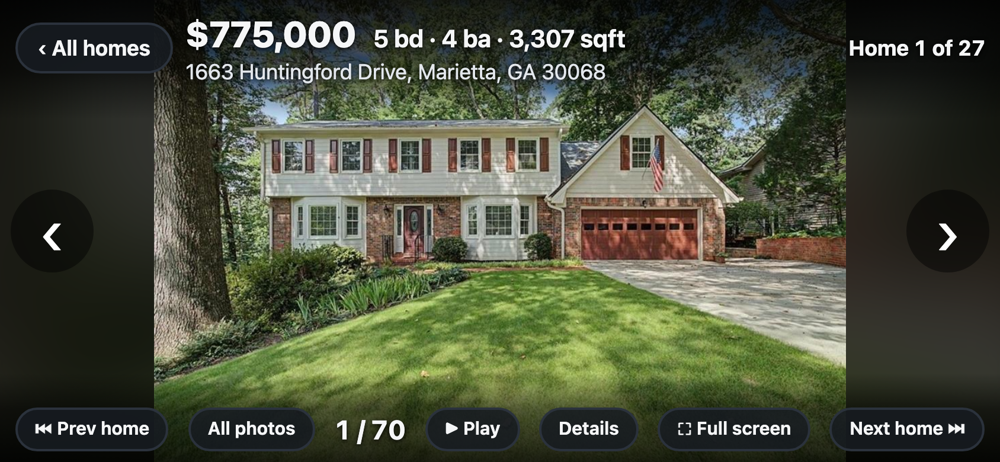
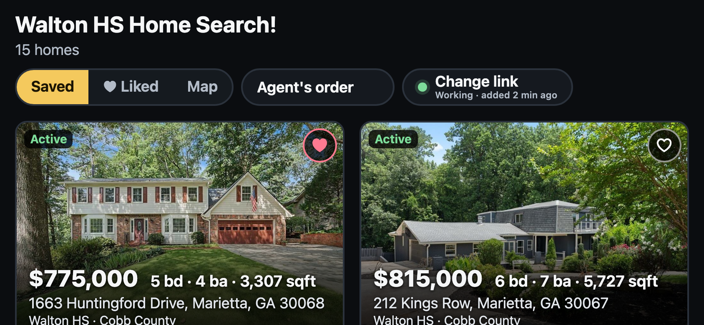
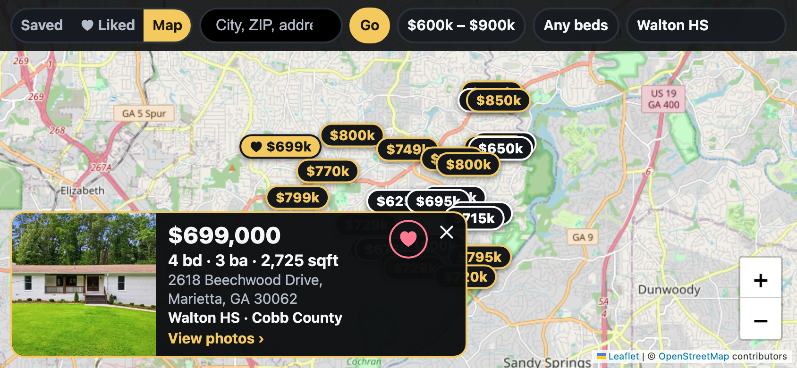

# OneHome big-screen viewer

A landscape, cast-friendly way to look through a OneHome saved search: large type, full-screen photos, one tap per photo.







## Run it

```sh
node server.js
```

No install step. It prints two addresses: one for this Mac, and one to open on your phone. The phone address can change when the Mac rejoins Wi-Fi; the terminal prints the current one each time. Use `PORT=4000 node server.js` for a different port (the default is 3210).

If the phone can't connect:

- Put the phone and the Mac on the same Wi-Fi, and not a guest network.
- If macOS asks whether `node` may accept incoming connections, choose Allow (System Settings → Network → Firewall).

While casting, set the phone's Auto-Lock to Never (iPhone: Settings → Display & Brightness → Auto-Lock) so the screen doesn't sleep mid-slideshow. The page can't keep the phone awake by itself over a plain `http://` address.

## Use it

- Tap a home to open its photos.
- Tap ♡ on a card, in the photo viewer or on a map card to like a home; tap ♥ to unlike it. **♥ Liked** lists them all, wherever you found them.
- Tap the right or left side of the screen (or swipe) for the next or previous photo. Going past the last photo moves to the next home.
- Swipe up or down, or use **Prev home** / **Next home**, to change homes.
- Tap the middle of the photo to hide or show the controls.
- **All photos** shows every photo for the home; **Details** shows schools, links to Google Maps and Street View, the facts and the description; **Play** runs a slideshow.
- With a keyboard: arrow keys, Space (play), `i` (details), `l` (like), `g` (all photos), `f` (full screen), Esc (back).

### Map

**Map** (next to **Saved**) searches every home for sale in your agent's MLS, not just the saved search.

- Pick a price range, a minimum number of bedrooms and a high school. The map remembers these and where you left it. It shows houses only.
- The high-school list is built from the homes for sale in view, so move the map if the school you want is missing.
- Tap the search box (it grows to fill the bar while you type), enter a city, ZIP or street address and press **Go**, then pick a place to move the map there, or a home to jump straight to it.
- Each pin shows a price; homes from your saved search are outlined in gold and liked homes carry a ♥. Blue bubbles are groups of homes: tap one to zoom in.
- Tap a pin for a summary card with the high school and county, then the card for photos. **Next home** then moves through the homes on the map.

The map only covers the MLS your link belongs to, so other regions come up empty.

On iPhone, Safari keeps its toolbars on screen. To get rid of them, use Share → **Add to Home Screen** and open it from the icon.

## Purchase history and FLIP

**Details** lists the home's past sales and transfers from county records, newest first. Transfers with no price (between family, trusts or lenders) are shown but not treated as sales.

A home is marked **FLIP**, next to its price, when both of these are true:

- its most recent market sale was less than 12 months before it was listed, and
- it is listed at least 20% above that sale price.

To change the rule, start the server with other numbers, for example `FLIP_MONTHS=24 FLIP_MIN_INCREASE_PERCENT=25 node server.js`. Some homes have no county record attached, and those show no history.


Likes are kept in `likes.json` next to `config.json`, on the machine running the server, so every phone and computer using this server sees the same list. They are not sent to OneHome, and your agent does not see them.

## Links and saved searches

Each link in your agent's emails opens one saved search. OneHome only lists all your searches after a full sign-in, which these links don't provide, so this app can't discover the others by itself. To add another search, tap **Change link** and paste the link from that search's email; a picker then appears next to **Saved** to switch between them. Links sent to different email addresses work too, as long as they belong to the same OneHome account. A link for a different account replaces everything.

You can also take the OneHome link and swap `https://portal.onehome.com/en-US/properties/list` for this server's address, keeping everything from `?token=` on.

The **Change link** button shows whether OneHome still accepts the link and when you added it; it turns amber when the link stops working. OneHome's emailed links carry no expiry date, so there is nothing to count down: a link lasts until OneHome stops accepting it. If a link ever does include an expiry, the button shows the time left instead.

The link is saved in `config.json` next to `server.js`. That file is git-ignored: a link grants access to that search, so treat it like the email it came from. On first run there is no link yet, and the page asks you to paste one.

## How it works

`server.js` exchanges the link's token for a OneHome session, reads the saved search and its homes, and passes photos through at `/img/<home>/<n>` (OneHome's own photo addresses expire after 30 minutes, so the server renews them as needed). It only reads from OneHome; it never marks homes as viewed, liked or disliked there.

Two outside services are used by the map: map pictures come from OpenStreetMap's tile servers, and place names typed into the search box are looked up with OpenStreetMap's Nominatim geocoder. [Leaflet](https://leafletjs.com) 1.9.4 (BSD-2-Clause) is included in `public/`.

## Run it in Docker

```sh
docker compose up -d --build
```

Then open `http://<address of the Docker machine>:3210` on your phone. The address the container prints in its log is its own internal one, so use the host machine's address instead.

Without Compose:

```sh
docker build -t onehome-bigscreen .
docker run -d --name onehome -p 3210:3210 -v onehome-data:/data --restart unless-stopped onehome-bigscreen
```

Links pasted through **Change link** and your likes are saved to `/data/config.json` and `/data/likes.json` in the `onehome-data` volume, so they survive rebuilds. The image itself contains no link; paste one the first time you open the page.
